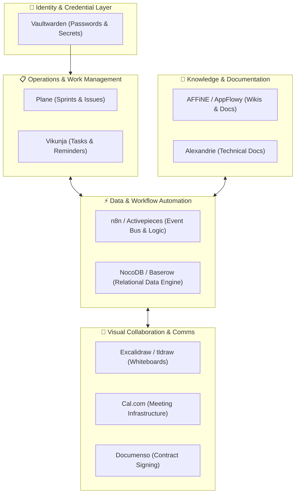

# 🚀 Awesome Business Utility & Productivity Tools

  
  
  
  
  
  
  

**A curated index of best-in-class SaaS platforms, cloud utilities, and self-hosted open-source GitHub alternatives.**  
*Empowering modern businesses, startups, and developer teams to automate workflows, organize institutional knowledge, orchestrate projects, and eliminate operational friction.*

---

## 📑 Table of Contents
- [🌐 Sector Overview & Market Dynamics](#-sector-overview--market-dynamics)
- [💼 Top SaaS Products](#-top-saas-products)
- [🛠️ Open-Source GitHub Projects](#️-open-source-github-projects)
- [🏗️ Architectural Recipes: Building Sovereign Stacks](#️-architectural-recipes-building-sovereign-stacks)
- [🤝 How to Contribute](#-how-to-contribute)
- [💖 Support & Sponsorship](#-support--sponsorship)
- [📈 Star History](#-star-history)
- [⚖️ Disclaimer](#️-disclaimer)

---

## 🌐 Sector Overview & Market Dynamics

The global business utility and productivity software market is currently valued at approximately **$104 billion to $110 billion** and continues to expand rapidly at a compound annual growth rate (CAGR) of 11% to 12%. 

In terms of structure, the sector exhibits a dual dynamic: it is **moderately concentrated at the suite and platform layer** (dominated by enterprise anchors such as Microsoft 365, Google Workspace, and Salesforce), yet **highly fragmented at the specialized application and utility layer** (where dedicated workflow automation, visual collaboration, note-taking, and scheduling engines compete intensely on user experience, developer extensibility, and domain-specific depth rather than a winner-take-all monopoly).

---

## 💼 Top SaaS Products

The table below lists leading commercial business utilities sorted in descending order by estimated market valuation and revenue size.

| Product | Size / Valuation / ARR | Category & Core Value Proposition | Pricing (Starting Paid Tier) | Free Tier / Trial Limits |
| :--- | :--- | :--- | :--- | :--- |
| **[Zoho Workplace](https://www.zoho.com/workplace/)** | **~$12.5B Valuation** *(~$1.5B ARR)* | Integrated cloud enterprise office suite (Mail, WorkDrive, Docs, Sheets, Cliq team chat, and Meetings). | **Standard:** $3/user/month (billed annually) for 30 GB mail storage & 10 GB shared WorkDrive storage. | **Free Plan:** Free forever for up to 5 users, 5 GB mail storage per user, and web-only client access. |
| **[Notion](https://www.notion.so/)** | **$11B Valuation** *(~$600M–$865M ARR)* | Flexible all-in-one collaborative workspace combining docs, wikis, relational databases, and project boards. | **Plus:** $10/user/month (billed annually) with unlimited file uploads, 30-day version history, and 100 guest invites. | **Free Plan:** Free forever for individuals with unlimited pages/blocks, up to 10 guest collaborators, and 5 MB file upload limit. |
| **[Zapier](https://zapier.com/)** | **$5B Valuation** *(~$310M ARR)* | No-code enterprise workflow automation middleware integrating 7,000+ business applications. | **Professional:** $19.99/month (billed annually) for 750 tasks/month, multi-step Zaps, webhooks, and filters. | **Free Plan:** Free forever with 100 tasks/month, single-trigger/single-action (2-step) Zaps, and 15-minute update frequency. |
| **[ClickUp](https://clickup.com/)** | **$4B Valuation** *(~$300M ARR)* | Converged project management suite unifying tasks, documents, real-time chat, whiteboards, goals, and dashboards. | **Unlimited:** $7/user/month (billed annually) with unlimited storage, unlimited integrations, and Gantt charts. | **Free Forever Plan:** 100 MB file storage limit, unlimited tasks, unlimited members, and 100 automation actions/month. |
| **[Calendly](https://calendly.com/)** | **$3B Valuation** *(~$275M ARR)* | Automated meeting scheduling and calendar coordination platform eliminating back-and-forth emails. | **Standard:** $10/seat/month (billed annually) for unlimited active event types, multiple calendars, and automated reminders. | **Free Plan:** Free forever with 1 active event type, 1 connected calendar, and standard 1-on-1 booking functionality. |
| **[Airtable](https://airtable.com/)** | **$1.285B Acquired EV** *(~$480M ARR)* | Low-code relational database-spreadsheet hybrid with dynamic views (Grid, Kanban, Calendar, Timeline, Gantt). | **Team:** $20/seat/month (billed annually) for 50,000 records/base, 20 GB attachments/base, and 25,000 automation runs. | **Free Plan:** Free forever for up to 5 editors with unlimited bases, 1,000 records/base, 1 GB attachments, and 100 automation runs/month. |
| **[Miro](https://miro.com/)** | **$1.355B Acquired EV** *(~$600M ARR)* | Visual collaboration canvas and infinite whiteboard platform for design thinking, agile mapping, and workshops. | **Starter:** $8/member/month (billed annually) with unlimited boards, private board sharing, and high-resolution exports. | **Free Plan:** Free forever with 3 editable boards, core integrations (Slack, Google Drive), and premade template library. |
| **[Loom](https://www.loom.com/)** | **$975M Acquisition** *(~$50M ARR)* | Asynchronous video recording and instant screen-sharing platform with automated transcription and AI insights. | **Business:** $12.50/creator/month (billed annually) for unlimited videos, unlimited recording length, and 4K recording. | **Free Plan:** Free forever for up to 25 videos per creator with a maximum 5-minute recording duration limit per video. |
| **[Bitwarden](https://bitwarden.com/)** | **$100M+ Raised** *(Private Scale)* | Zero-knowledge, open-cloud password vault and secrets manager for distributed workforce security. | **Premium:** $10/year ($0.83/month) for individual advanced 2FA; **Teams:** $4/user/month for event logs and directory sync. | **Free Plan:** Free forever for 1 user across unlimited devices with unlimited password and secure note storage. |
| **[IFTTT](https://ifttt.com/)** | **~$96M Valuation** *(~$5M–$8M ARR)* | Lightweight event-driven trigger-action automation engine connecting mobile devices, IoT hardware, and web APIs. | **Pro:** $3.49/month (billed annually) for 20 multi-action Applets, faster query polling, and filter logic. | **Free Plan:** Free forever for up to 2 active Applets with standard polling and unlimited applet runs. |

---

## 🛠️ Open-Source GitHub Projects

Self-hostable, sovereign, and privacy-respecting alternatives that liberate organizations from proprietary lock-in. Sorted in descending order by GitHub Stars_Count:

- **[n8n](https://github.com/n8n-io/n8n)**   
  *Fair-code workflow automation platform with native AI agent orchestration and 400+ pre-built integrations.*  
  Enables developers to visually construct multi-step business logic, write custom JavaScript/Python transformations, execute self-hosted webhooks, and replace commercial Zapier workflows with full data governance.

- **[Excalidraw](https://github.com/excalidraw/excalidraw)**   
  *Virtual hand-drawn whiteboard for collaborative architecture diagrams and wireframes.*  
  Offers end-to-end encryption, infinite canvas navigation, live multi-cursor collaboration, and flexible export capabilities without external SaaS tracking.

- **[AppFlowy](https://github.com/AppFlowy-IO/AppFlowy)**   
  *Privacy-first, open-source collaborative workspace alternative to Notion.*  
  Engineered with Flutter and Rust for high performance, local-first offline support, complete data sovereignty, AI-assisted writing, and database views.

- **[AFFiNE](https://github.com/toeverything/AFFiNE)**   
  *Next-gen all-in-one knowledge base uniting structured Markdown documents and Miro-style whiteboards.*  
  Features an offline-first architecture, customizable canvas modes, and seamless self-hosting via Docker Compose.

- **[Vaultwarden](https://github.com/dani-garcia/vaultwarden)**   
  *Lightweight Bitwarden-compatible password vault backend implemented in Rust.*  
  Provides full compatibility with official Bitwarden browser extensions, desktop clients, and mobile apps while consuming negligible memory.

- **[NocoDB](https://github.com/nocodb/nocodb)**   
  *Open-source smart spreadsheet and no-code database turning relational databases into Airtable interfaces.*  
  Connects directly to PostgreSQL, MySQL, SQL Server, and SQLite with collaborative Grid, Gallery, Form, and Kanban views.

- **[Plane](https://github.com/makeplane/plane)**   
  *Open-source project management platform built as an alternative to Jira, Linear, and ClickUp.*  
  Offers sprint cycles, module tracking, live issue triage, documentation pages, and GitHub synchronization in a responsive, modern interface.

- **[Twenty](https://github.com/twentyhq/twenty)**   
  *Modern open-source CRM platform engineered as a modular alternative to Salesforce and HubSpot.*  
  Provides full control over customer relational data, customizable pipelines, GraphQL/REST APIs, and native AI capabilities.

- **[tldraw](https://github.com/tldraw/tldraw)**   
  *Ultra-responsive infinite canvas library and collaborative digital whiteboard SDK.*  
  Powers embeddable diagramming, custom interactive canvas experiences, and team brainstorms with a minimalistic React toolkit.

- **[Cal.com](https://github.com/calcom/cal.com)**   
  *Extensible, enterprise-grade scheduling infrastructure and Calendly alternative.*  
  Offers white-label calendar bookings, round-robin team scheduling, video routing, custom webhook webhooks, and self-hosted deployment.

- **[Focalboard](https://github.com/mattermost-community/focalboard)**   
  *Self-hosted multilingual project tracking dashboard and Trello/Asana alternative from Mattermost.*  
  Organizes personal and team deliverables across kanban boards, table grids, and calendar timelines.

- **[Activepieces](https://github.com/activepieces/activepieces)**   
  *MIT-licensed no-code business automation tool with AI agent orchestration and MCP server support.*  
  Empowers teams to assemble event-driven flows, integrate internal APIs, and automate operational workflows with self-hosted Docker containers.

- **[Documenso](https://github.com/documenso/documenso)**   
  *The open-source digital signing platform and modern alternative to DocuSign.*  
  Enables verifiable, cryptographically secured document signing workflows, custom templates, and automated signing pipelines.

- **[Baserow](https://github.com/baserow/baserow)**   
  *No-code modular database platform designed for enterprise scale and Airtable parity.*  
  Handles tens of millions of records, real-time collaboration, API triggers, and customized workflow automation without seat-based pricing traps.

- **[Vikunja](https://github.com/go-vikunja/vikunja)**   
  *The to-do list and task management system you genuinely own and host.*  
  Features Gantt charts, subtasks, deadlines, reminders, kanban boards, and CalDAV synchronization.

- **[Rallly](https://github.com/lukevella/rallly)**   
  *Open-source meeting scheduling and consensus polling tool.*  
  Replaces Doodle and When2meet with a clean, ad-free interface for finding mutual availability across distributed groups.

- **[Alexandrie](https://github.com/Smaug6739/Alexandrie)**   
  *Self-hosted, offline-first Markdown knowledge base and documentation portal.*  
  Includes multi-tenant team management, OIDC/SSO authentication, S3 backup integration, and instant one-command deployment.

---

## 🏗️ Architectural Recipes: Building Sovereign Stacks

You can combine these modular open-source building blocks into a production-ready, vendor-neutral operating stack:

---

## 🤝 How to Contribute

Contributions, bug reports, and suggestions are warmly welcome!

1. 🍴 **Fork the repository** on GitHub.
2. 🌿 **Create a new branch**: `git checkout -b feature/amazing-tool`.
3. 📝 **Add your entry** under the appropriate section adhering to formatting standards.
4. 🔎 Ensure descriptions are factual, links point to canonical sources, and pricing/Stars_Badges are accurate.
5. 🚀 **Commit & push**: `git commit -m "Add AmazingTool" && git push origin feature/amazing-tool`.
6. 📬 **Submit a Pull Request** with a brief summary of the project.

---

## 💖 Support & Sponsorship

If you find this curated directory helpful for your workflows, projects, or organization, please consider supporting the ongoing maintenance and curation!

- ⭐ **Star this repository** to help others discover it.
- 🍴 **Fork and share** it with your developer and operations networks.
- ☕ **Sponsor or buy a coffee**: Support the author directly via the [GitHub Sponsors Dashboard](https://github.com/sponsors/ishandutta2007).

Thank you for your encouragement and support in keeping business utilities open, transparent, and sovereign! 🙌

---

## 📈 Star History

---

## ⚖️ Disclaimer

- This repository is a community-curated index compiled for educational and organizational reference; inclusion does not constitute a formal commercial endorsement.
- All trademarks, logos, and brand names are the property of their respective owners.
- When self-hosting tools that process sensitive business or customer data, organizations must implement adequate security safeguards (including automated offsite backups, least-privilege API scoping, TLS encryption, and compliance with applicable data privacy regulations such as GDPR and CCPA).

---

  <b>Built for operations leads, developers, and organizations building sovereign workflows. 🌐</b>

